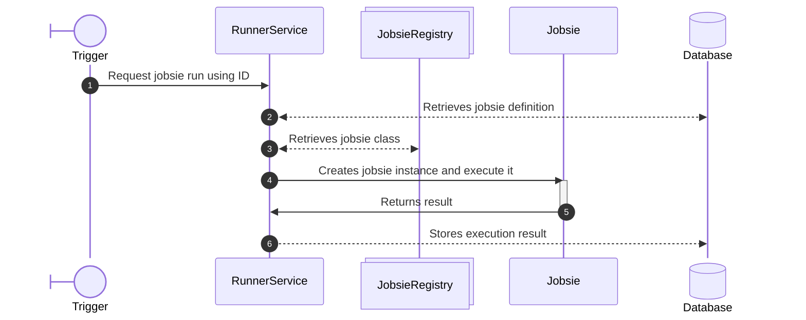
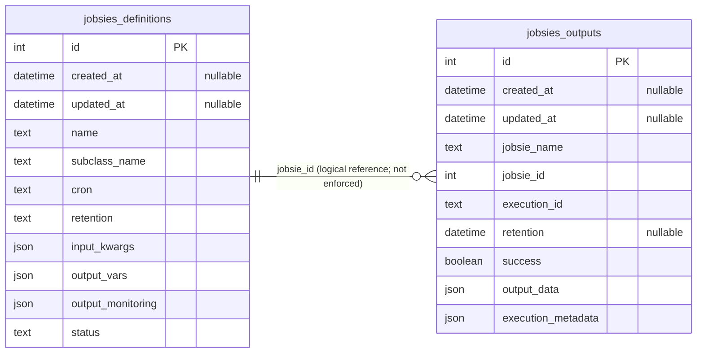
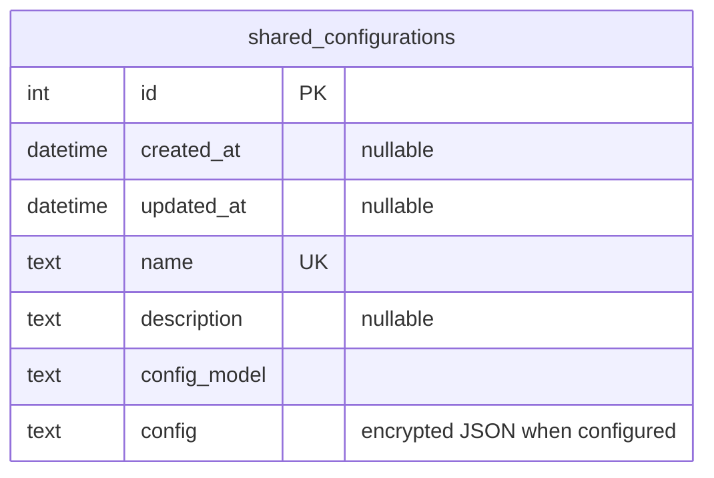

Bellow you can find important architecture diagrams and high level ideas on how `jobsies` are implemented. 

## Manifest

Jobsie is

## Overall

## Executing jobsies

Jobsies are always executed by the `RunnerService` as a sole interface for the execution. The execution follow this scheme:

> Sequence diagram of how jobsie execution happens

where trigger can be: scheduled execution, API call, or user pressing the run button.

## Database

## Plugin system
